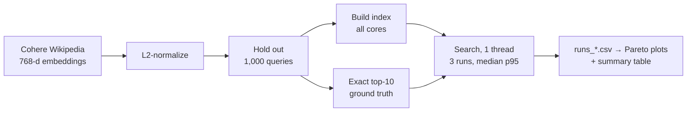

# Vector search at scale

[](https://github.com/Sankew/vector-search-at-scale/actions/workflows/checks.yml)

How much recall does each FAISS index give up for speed and memory? This benchmark measures recall@10, single-query p95 latency, batch throughput and memory for three index families on one dataset, at 100k, 250k and 1M vectors:

- **HNSW (float32)**, swept over M ∈ {16, 32, 64} × efConstruction ∈ {100, 200} × efSearch ∈ {16 … 512}
- **HNSW-SQ8**, 8-bit scalar quantization (about 4× smaller vectors)
- **Binary + rescore**, sign-bit codes searched by Hamming distance, with the top k × oversample candidates rescored against float vectors. The float rescoring store is counted in the memory figure.



## Results

**Pending.** The numbers must come from a native run on an Apple M4 (4P + 6E cores, 16 GB). The code is tested in CI and on synthetic vectors, and those synthetic runs are not results. After the run, `results/summary.md` and the two plots below are committed:

- `results/recall_vs_latency.png`: recall@10 against p95 single-query latency, with the Pareto front
- `results/recall_vs_memory.png`: recall@10 against total memory
- `results/summary.md`: three picks (max recall, fastest at recall ≥ 0.95, smallest at recall ≥ 0.90) and the scale table
- `results/env.json`: Python, FAISS and BLAS versions, compile options, thread settings, dataset revision, power source, Low Power Mode, and swap at start and end

## Run

Python 3.12 and [uv](https://docs.astral.sh/uv/):

```bash
uv sync
uv run python vss.py prepare --source cohere --n 1000000   # reads only the emb column over HTTP
uv run python vss.py run --scales 100000 250000 1000000     # full sweep at the largest scale
uv run python vss.py report
uv run --group dev pytest -q
```

No internet or not much time? `prepare --source synthetic --n 50000` generates clustered vectors, and the rest of the pipeline runs unchanged.

Before a real run on a Mac: AC power, Low Power Mode off, other apps closed, and `sysctl vm.swapusage` showing no swap in use (`env.json` records it at start). Searches run single-threaded (`OMP_NUM_THREADS`, `VECLIB_MAXIMUM_THREADS` and FAISS's own OpenMP setting are all pinned to 1). Index builds use every core and are timed separately.

## Method

- **Data:** [`Cohere/wikipedia-22-12-en-embeddings`](https://huggingface.co/datasets/Cohere/wikipedia-22-12-en-embeddings), first shards until 1,001,000 vectors at a pinned dataset revision, L2-normalized, shuffled with a fixed seed. The first 1,000 are queries, the rest is the base. Smaller scales are prefixes of the shuffled base, so every scale uses the same queries.
- **Ground truth:** exact inner-product top-10 per scale (`faiss.knn`), cached in `data/`.
- **Graphs:** the full M × efConstruction sweep runs at the largest scale. Smaller scales build M=32, efConstruction=200 only, and the scale table uses that graph at every scale.
- **Latency:** 100 warm-up queries, then 1,000 single-query searches timed individually, in a fresh random order on each of 3 runs; the table reports the median of the three p50 and p95 values. Batch QPS (all 1,000 queries in one call, one thread) is also the median of 3 runs.
- **Order:** index builds and each sweep's parameter order are shuffled with a fixed seed, so drift (thermal, background load) doesn't line up with one configuration.
- **Memory:** serialized index size; for binary, plus the float32 vectors it rescores against.

## Limitations

- Queries are held-out document vectors, not real search queries. That flatters recall compared with production traffic.
- ARM NEON numbers aren't comparable to published x86 benchmarks.
- The first shards of one Wikipedia dump aren't a uniform sample of it; shuffling only randomizes within what was downloaded.
- Single-query latency on a laptop with efficiency cores is noisy; the 3-run median reduces this but doesn't remove it.
- 5M vectors (about 15 GB as float32) doesn't fit the 16 GB machine, so it isn't measured.
