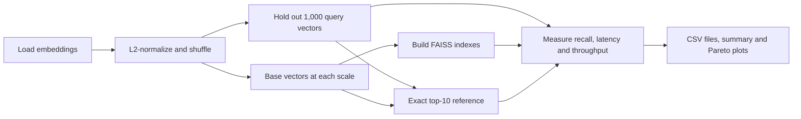
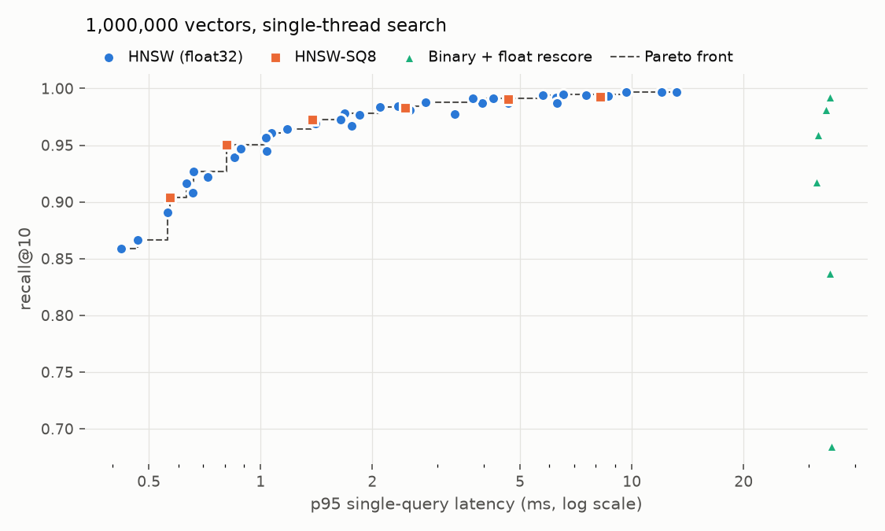
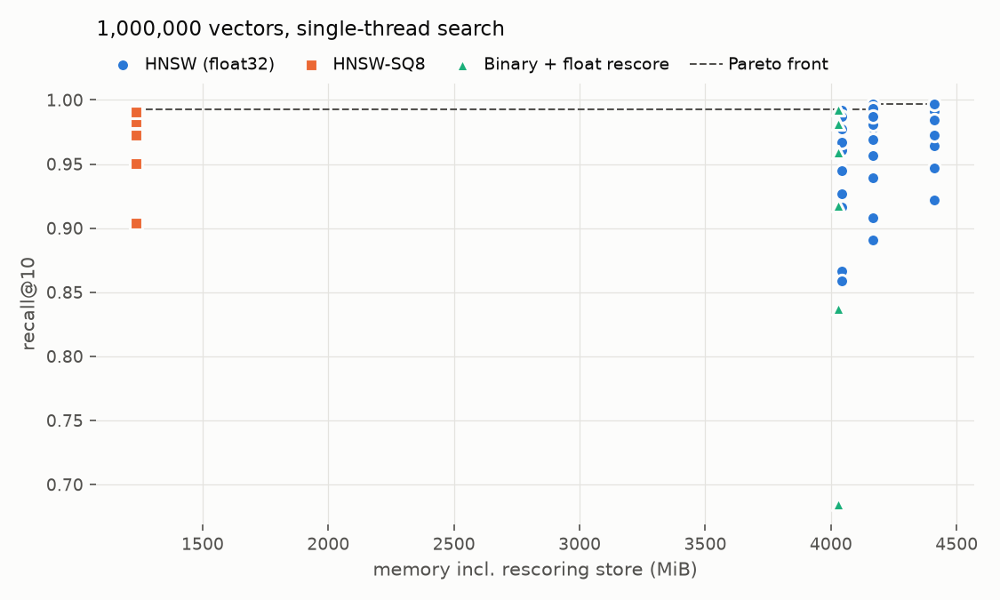

# Vector search at scale

[](https://github.com/Sankew/vector-search-at-scale/actions?query=branch%3Ap2-benchmark)

This benchmark compares the recall, latency and storage requirements of three FAISS index families. It provides a repeatable experiment at 100,000, 250,000 and 1,000,000 vectors, with exact search as the reference.

**Status:** automated tests and a small synthetic run pass CI. The benchmark has been run on 1,000,000 real embeddings on a cloud VM; see [Results](#results).

## Indexes compared

| Index | Search method | Storage counted |
|---|---|---|
| HNSW with float32 vectors | Approximate graph search using inner product | Serialized graph and float vectors |
| HNSW-SQ8 | Approximate graph search with 8-bit scalar-quantized vectors | Serialized graph and quantized vectors |
| Binary with float rescoring | Exact Hamming search over sign-bit codes, followed by inner-product rescoring of selected candidates | Serialized binary index plus the float32 rescoring store |

SQ8 reduces the vector representation to 8 bits per dimension; graph overhead remains. The binary method retains float vectors for rescoring, so the size of its binary codes alone would understate its storage requirement.



## Run

Use Python 3.12 and uv. Run commands from the repository root.

```bash
uv sync --locked --group dev
uv run --locked python vss.py prepare --source cohere --n 1000000
uv run --locked python vss.py run --scales 100000 250000 1000000
uv run --locked python vss.py report
```

`prepare` downloads the embedding column from the English subset of Cohere's Wikipedia embeddings. `--n` is the number of base vectors; another 1,000 vectors are loaded for queries. The full parameter sweep runs at the largest scale by default. If a run is interrupted, `run --resume` with the same scales keeps every configuration that finished and redoes the rest.

### Small synthetic run

After installing dependencies, this example needs no dataset download:

```bash
uv run --locked python vss.py prepare --source synthetic --n 3000 --dim 64
uv run --locked python vss.py run --scales 1000 3000 --runs 1
uv run --locked python vss.py report
```

The selected scales must fit within the prepared base. These small sizes and one timing repetition keep the smoke test short; they are not the settings for the real benchmark.

Prepared data and results live in `data/` and `results/` under the working directory. Preparing another dataset replaces the prepared vectors and clears cached ground truth. Preserve any real benchmark artifacts before using the same directory for synthetic runs.

### Tests

```bash
uv run --locked --group dev pytest -q
```

CI runs the tests and the synthetic prepare/run/report sequence above.

## Method

### Data and ground truth

The real dataset is the English subset of `CohereLabs/wikipedia-2023-11-embed-multilingual-v3`: Wikipedia passages embedded with Cohere's `embed-multilingual-v3` model, 1,024 dimensions. The benchmark was first written for `Cohere/wikipedia-22-12-en-embeddings` (768 dimensions), which Hugging Face no longer serves. Preparation resolves the dataset's current revision, reads the first sorted English shards at that revision, and records it in `data/source.json`. It does not pin every future preparation to the same revision.

For the million-vector run, 1,001,000 vectors are L2-normalized and shuffled with seed 0. The first 1,000 become queries; the rest form the base. Smaller scales use prefixes of that base and the same queries.

Exact inner-product top-10 results are computed separately for each scale with `faiss.knn` and cached in `data/`. On normalized vectors, inner product gives the same ordering as cosine similarity. Recall@10 is the mean fraction of these exact neighbours returned by each index.

### Parameters

| Index | Parameters swept |
|---|---|
| Float32 HNSW, largest scale | `M`: 16, 32, 64; `efConstruction`: 100, 200; `efSearch`: 16, 32, 64, 128, 256, 512 |
| Float32 HNSW, smaller scales | `M=32`, `efConstruction=200`; the same `efSearch` sweep |
| HNSW-SQ8, every scale | `M=32`, `efConstruction=200`; the same `efSearch` sweep |
| Binary with rescoring, every scale | Candidate oversampling: 1, 2, 4, 8, 16, 32 times the requested top 10, capped at the base size |

SQ8 trains on up to the first 100,000 base vectors. The scale table uses the common HNSW configuration, `M=32` and `efConstruction=200`, so its rows compare the same graph settings across scales.

### Timing and storage

- **Search:** one thread, with BLAS/OpenMP environment settings and FAISS's search thread count fixed to 1.
- **Build:** timed separately, with FAISS's OpenMP thread count set to the detected CPU count. BLAS thread settings remain fixed to 1.
- **Latency:** 100 warm-up queries, followed by 1,000 individually timed queries in a new deterministic random order for each repetition. Default runs use three repetitions and report the median p50 and p95.
- **Throughput:** all 1,000 queries in one batch, using one search thread; batch QPS is the median across repetitions.
- **Order:** index builds and parameter settings are shuffled with a fixed seed to reduce alignment between a configuration and gradual machine drift.
- **Storage:** serialized index size plus the float32 rescoring store for the binary method. This is not peak process memory or total memory needed during preparation and building.

For a native Mac benchmark, use AC power, disable Low Power Mode and minimise competing work. `results/env.json` records the platform, library versions, FAISS compile options and thread settings. On macOS, it also records the CPU, power source, Low Power Mode and swap at the start and end. Interpret timings alongside those conditions.

## Reports

A completed run produces:

| File | Contents |
|---|---|
| `results/runs_<scale>.csv` | Recall, latency, throughput, build time and storage for each configuration |
| `results/run_manifest.json` | Selected scales, prepared-data fingerprint and completion status |
| `results/env.json` | Software, hardware and run conditions |
| `results/summary.md` | Maximum-recall choice, fastest choice at recall ≥ 0.95, smallest choice at recall ≥ 0.90, and a scale comparison |
| `results/recall_vs_latency.png` | Recall against p95 single-query latency, with the Pareto front |
| `results/recall_vs_memory.png` | Recall against serialized index size plus rescoring storage, with the Pareto front |

The plots and configuration picks use the largest measured scale. The report refuses an incomplete run or prepared data whose fingerprint changed after the run. It reads only the scales listed in the run manifest, excluding CSV files left by older scale selections.

## Results

Measured on 2026-10-13 with 1,000,000 base vectors and 1,000 queries from revision `ade45fb` of the CohereLabs English subset, plus its 100,000 and 250,000 prefixes. Every row is in `results/runs_<scale>.csv`, the configuration picks in `results/summary.md`, and the machine in `results/env.json`. Sizes are MiB (2<sup>20</sup> bytes), as are the CSV `_mb` columns.

The run used a cloud VM, not a Mac: Ubuntu 24.04 in a container, 4 vCPUs of an Intel Xeon at 2.80 GHz with AVX-512, 15 GiB of RAM and FAISS 1.15.1 built with AVX-512. Recall and storage depend only on the data and the index settings. Latency, throughput and build times belong to this machine, and a shared VM is noisier than an idle laptop. Builds used all 4 vCPUs; searches used one thread. The first run hit a two-hour job time limit during the million-vector binary sweep, so those six rows were measured again by `run --resume` in a fresh process.

### One million vectors

| Configuration | Size (MiB) | Build | efSearch 32: recall@10 / p95 | efSearch 512: recall@10 / p95 |
|---|---:|---:|---|---|
| HNSW M=16, efC=200 | 4,044 | 647 s | 0.9266 / 0.66 ms | 0.9920 / 6.25 ms |
| HNSW M=32, efC=200 | 4,166 | 824 s | 0.9563 / 1.03 ms | 0.9965 / 9.68 ms |
| HNSW M=64, efC=200 | 4,410 | 958 s | 0.9639 / 1.18 ms | 0.9970 / 12.00 ms |
| HNSW-SQ8, M=32, efC=200 | **1,236** | 756 s | 0.9505 / **0.81 ms** | 0.9928 / 8.22 ms |
| Binary + float rescore | 4,028 | 8 s | 0.9595 / 31.70 ms at 8× | 0.9929 / 34.19 ms at 32× |

The binary row uses candidate oversampling in place of efSearch. The efConstruction=100 builds are in the CSV and the plots.





**Unless recall above about 0.99 is needed, HNSW-SQ8 is the better index on this data.** With the same graph settings it takes 30% of the space of float32 HNSW: the graph costs about 260 MiB in both, and SQ8 shrinks the vectors from 3,906 to 977 MiB. It was faster at every efSearch, for 0.004–0.006 less recall. At efSearch 32 it answered in 0.81 ms at p95, the fastest configuration in the sweep to reach recall 0.95. This is SQ8's own ranking, with no float rescoring.

**Binary codes with float rescoring were the slowest option and, as measured, saved no memory.** FAISS compares the query with every binary code, so latency follows the base size and barely depends on oversampling: p50 stayed between 23 and 26 ms at 1,000,000 vectors for every factor from 1× to 32×. Sign bits alone ranked poorly, with recall 0.685 at 1×. Recall passed 0.95 at 8× and reached 0.993 at 32×. The codes take 122 MiB, but rescoring reads float vectors held in memory, another 3,906 MiB. The binary index built in 8 seconds; the graphs took 5 to 16 minutes. Keeping the floats on disk, or indexing the codes with a graph or IVF, could change this result. Neither was measured.

**efConstruction and M.** For M=16 and M=32, efConstruction=100 roughly halved build time (647 → 319 s and 824 → 388 s) and lowered recall by 0.003–0.018 at the same efSearch. M=64 went the other way: efConstruction=100 gave higher recall at low efSearch (0.947 against 0.922 at efSearch 16) and higher latency. FAISS 1.15.1 prunes a node's candidate links with its neighbour-selection heuristic only when there are at least as many candidates as the level-0 link limit, 2 × M (`shrink_neighbor_list_inner` in `faiss/impl/HNSW.cpp`). For M=64 the limit is 128, which 100 candidates never reach, so links go unpruned. On a 30,000-vector sample of this data, mean level-0 degree was 80 with efConstruction=100 and 46 with 200. Extra links mean more distance computations per step, so recall rises at a given efSearch without improving the recall–latency curve: where these points are on the Pareto front, they lead a faster configuration by at most 0.0006 recall. That is also why the max-recall pick in `summary.md` is M=64 with efConstruction=100, ahead of efConstruction=200 by 0.0001. Doubling M from 32 to 64 added 244 MiB and 16% to the build for 0.0005 more recall at efSearch 512.

### Scale

Fastest p95 per family at recall@10 ≥ 0.95, with M=32 and efConstruction=200 at every scale:

| Vectors | HNSW | HNSW-SQ8 | Binary + rescore |
|---:|---:|---:|---:|
| 100,000 | 0.80 ms (efSearch 32) | 0.63 ms (efSearch 32) | 3.87 ms (16×) |
| 250,000 | 0.87 ms (efSearch 32) | 1.17 ms (efSearch 64) | 9.02 ms (16×) |
| 1,000,000 | 1.03 ms (efSearch 32) | 0.81 ms (efSearch 32) | 31.70 ms (8×) |

Over a tenfold increase in vectors, the graph indexes slowed only slightly, and recall at a fixed setting hardly moved: float HNSW at efSearch 32 scored 0.958, 0.956 and 0.956. The binary method's search time grew roughly in line with the base. The 1.17 ms for SQ8 at 250,000 vectors is a threshold effect rather than a slowdown. There, efSearch 32 reached 0.9493, just under 0.95, so the table takes efSearch 64.

## Limitations

- Queries are held-out document embeddings rather than embeddings of real user questions. Recall in this experiment does not measure answer quality in a retrieval system.
- The first dataset shards are not a uniform sample of the full Wikipedia collection. Shuffling changes order within the downloaded sample.
- Temperature, background activity, scheduling and, on a shared cloud VM, other tenants can affect latency. Repetitions reduce noise without removing it.
- Measurements depend on the hardware and FAISS build. They should not be treated as results for a different architecture or server.
- Reported storage excludes temporary arrays and build overhead. Larger scales need more memory than the final index size suggests.
- The run manifest checks completion and prepared-data identity; it is not an integrity check on every result row or a record of the code revision.
