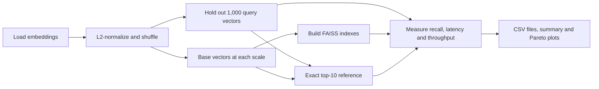

# Vector search at scale

[](https://github.com/Sankew/vector-search-at-scale/actions?query=branch%3Ap2-benchmark)

This benchmark compares the recall, latency and storage requirements of three FAISS index families. It provides a repeatable experiment at 100,000, 250,000 and 1,000,000 vectors, with exact search as the reference.

**Status:** automated tests and a small synthetic run pass CI. The million-vector benchmark on real embeddings is pending. Synthetic runs validate the implementation and reporting; they do not establish performance on the real dataset.

## Indexes compared

| Index | Search method | Storage counted |
|---|---|---|
| HNSW with float32 vectors | Approximate graph search using inner product | Serialized graph and float vectors |
| HNSW-SQ8 | Approximate graph search with 8-bit scalar-quantized vectors | Serialized graph and quantized vectors |
| Binary with float rescoring | Exact Hamming search over sign-bit codes, followed by inner-product rescoring of selected candidates | Serialized binary index plus the float32 rescoring store |

SQ8 reduces the vector representation to 8 bits per dimension; graph overhead remains. The binary method retains float vectors for rescoring, so the size of its binary codes alone would understate its storage requirement.



## Run

Use Python 3.12 and uv. Run commands from the repository root.

```bash
uv sync --locked --group dev
uv run --locked python vss.py prepare --source cohere --n 1000000
uv run --locked python vss.py run --scales 100000 250000 1000000
uv run --locked python vss.py report
```

`prepare` downloads the embedding column from the Cohere Wikipedia dataset. `--n` is the number of base vectors; another 1,000 vectors are loaded for queries. The full parameter sweep runs at the largest scale by default.

### Small synthetic run

After installing dependencies, this example needs no dataset download:

```bash
uv run --locked python vss.py prepare --source synthetic --n 3000 --dim 64
uv run --locked python vss.py run --scales 1000 3000 --runs 1
uv run --locked python vss.py report
```

The selected scales must fit within the prepared base. These small sizes and one timing repetition keep the smoke test short; they are not the settings for the real benchmark.

Prepared data and results live in `data/` and `results/` under the working directory. Preparing another dataset replaces the prepared vectors and clears cached ground truth. Preserve any real benchmark artifacts before using the same directory for synthetic runs.

### Tests

```bash
uv run --locked --group dev pytest -q
```

CI runs the tests and the synthetic prepare/run/report sequence above.

## Method

### Data and ground truth

The real dataset is `Cohere/wikipedia-22-12-en-embeddings`, with 768-dimensional document embeddings. Preparation resolves the dataset's current revision, reads the first sorted shards at that revision, and records it in `data/source.json`. It does not pin every future preparation to the same revision.

For the million-vector run, 1,001,000 vectors are L2-normalized and shuffled with seed 0. The first 1,000 become queries; the rest form the base. Smaller scales use prefixes of that base and the same queries.

Exact inner-product top-10 results are computed separately for each scale with `faiss.knn` and cached in `data/`. On normalized vectors, inner product gives the same ordering as cosine similarity. Recall@10 is the mean fraction of these exact neighbours returned by each index.

### Parameters

| Index | Parameters swept |
|---|---|
| Float32 HNSW, largest scale | `M`: 16, 32, 64; `efConstruction`: 100, 200; `efSearch`: 16, 32, 64, 128, 256, 512 |
| Float32 HNSW, smaller scales | `M=32`, `efConstruction=200`; the same `efSearch` sweep |
| HNSW-SQ8, every scale | `M=32`, `efConstruction=200`; the same `efSearch` sweep |
| Binary with rescoring, every scale | Candidate oversampling: 1, 2, 4, 8, 16, 32 times the requested top 10, capped at the base size |

SQ8 trains on up to the first 100,000 base vectors. The scale table uses the common HNSW configuration, `M=32` and `efConstruction=200`, so its rows compare the same graph settings across scales.

### Timing and storage

- **Search:** one thread, with BLAS/OpenMP environment settings and FAISS's search thread count fixed to 1.
- **Build:** timed separately, with FAISS's OpenMP thread count set to the detected CPU count. BLAS thread settings remain fixed to 1.
- **Latency:** 100 warm-up queries, followed by 1,000 individually timed queries in a new deterministic random order for each repetition. Default runs use three repetitions and report the median p50 and p95.
- **Throughput:** all 1,000 queries in one batch, using one search thread; batch QPS is the median across repetitions.
- **Order:** index builds and parameter settings are shuffled with a fixed seed to reduce alignment between a configuration and gradual machine drift.
- **Storage:** serialized index size plus the float32 rescoring store for the binary method. This is not peak process memory or total memory needed during preparation and building.

For a native Mac benchmark, use AC power, disable Low Power Mode and minimise competing work. `results/env.json` records the platform, library versions, FAISS compile options and thread settings. On macOS, it also records the CPU, power source, Low Power Mode and swap at the start and end. Interpret timings alongside those conditions.

## Reports

A completed run produces:

| File | Contents |
|---|---|
| `results/runs_<scale>.csv` | Recall, latency, throughput, build time and storage for each configuration |
| `results/run_manifest.json` | Selected scales, prepared-data fingerprint and completion status |
| `results/env.json` | Software, hardware and run conditions |
| `results/summary.md` | Maximum-recall choice, fastest choice at recall ≥ 0.95, smallest choice at recall ≥ 0.90, and a scale comparison |
| `results/recall_vs_latency.png` | Recall against p95 single-query latency, with the Pareto front |
| `results/recall_vs_memory.png` | Recall against serialized index size plus rescoring storage, with the Pareto front |

The plots and configuration picks use the largest measured scale. The report refuses an incomplete run or prepared data whose fingerprint changed after the run. It reads only the scales listed in the run manifest, excluding CSV files left by older scale selections.

## Limitations

- Queries are held-out document embeddings rather than embeddings of real user questions. Recall in this experiment does not measure answer quality in a retrieval system.
- The first dataset shards are not a uniform sample of the full Wikipedia collection. Shuffling changes order within the downloaded sample.
- Laptop temperature, background activity and scheduling can affect latency. Repetitions reduce noise without removing it.
- Measurements depend on the hardware and FAISS build. They should not be treated as results for a different architecture or server.
- Reported storage excludes temporary arrays and build overhead. Larger scales need more memory than the final index size suggests.
- The run manifest checks completion and prepared-data identity; it is not an integrity check on every result row or a record of the code revision.
